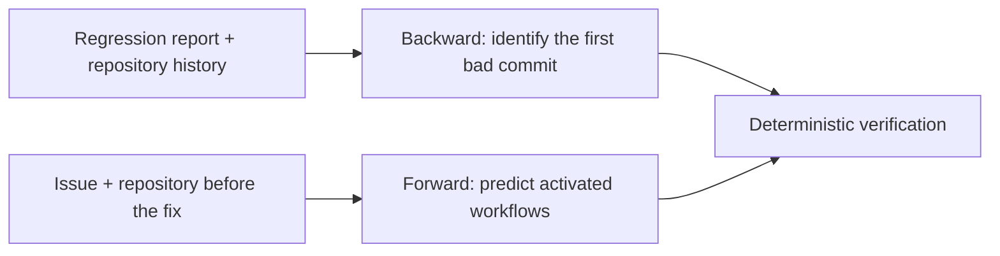

<h1 align="center">SWE-Time: Benchmarking Temporal Repository Understanding</h1>

<p align="center">
  <a href="task_backward/manifest.jsonl"></a>
  <a href="task_forward/manifest.jsonl"></a>
  <a href="https://github.com/harbor-framework/harbor"></a>
</p>

<p align="center">
  <a href="https://www.python.org/"></a>
  <a href="https://www.docker.com/"></a>
  <a href="https://git-scm.com/"></a>
</p>

This is the official repository of the benchmark introduced in the paper
**SWE-Time: Benchmarking Temporal Repository Understanding**.

SWE-Time evaluates whether coding agents can reason about a repository across time, in two
directions:

## 🧭 Benchmark overview

| Task | Directory | Cases | Repos | Question | Answer | Metric |
|---|---|--:|--:|---|---|---|
| **Backward** | `task_backward/` | 631 | 49 | Given a regression report and the repository history up to the report, which commit introduced the regression? | `/testbed/answer.txt`: the 40-char SHA of the first bad commit | Exact |
| **Forward** | `task_forward/` | 1030 | 16 | Given an issue and the repository just before it was fixed, which GitHub Actions workflows will the fixing pull request activate? | `/testbed/answer.json`: `{"activated_workflows": [...]}` | Workflow Exact |

Every case comes from a real issue and its real fix. Gold is deterministic: Backward Gold is the
first-bad-commit SHA, and Forward Gold is computed from the repository's own workflow YAML by a
rule-based evaluator (`task_forward/evaluator/`). No model is used to judge answers.

Tasks are in [Harbor](https://github.com/harbor-framework/harbor) format. This repository
ships the task definitions, Gold, verifiers and scorers, plus scripts that rebuild each case's
repository from public GitHub. It does not ship repository contents or prebuilt images.



## 📂 Repository layout

```
base_image/          shared base image (python:3.11-slim + git, ripgrep)
task_backward/       Backward
  tasks/<case>/      instruction.md, task.toml, environment/Dockerfile, tests/, solution/
  manifest.jsonl     one line per case: repo, cutoff_sha, labels, integrity digests
  rebuild/           rebuild.py (+ artifacts.py, the rules for hidden changelog files)
  verifier/          grade.py, probe.py, test.sh (copied into every task's tests/)
  score.py           batch scorer
task_forward/        Forward
  tasks/<case>/      same layout as above
  manifest.jsonl     one line per case: repo, base_sha, base_ref, labels, tree_digest
  rebuild/           rebuild.py
  evaluator/         gold_routing.py (the Gold rules) + test_gold_routing.py
  verifier/          verify.py, tree_digest.py, test.sh
  score.py           batch scorer
```

## ⚙️ Requirements

- Linux with Docker, Python 3.10+ and git.
- Network access to github.com for rebuilding repositories.
- Disk: Forward needs a few GB. Backward clones the full history of 49 repositories, including
  large ones (llvm-project, rust, kubernetes); plan for several hundred GB, or rebuild a subset
  with `--cases`.

## 🐳 1. Build the base image

```bash
docker build -t swe-time/base:1 base_image/
```

## 🛠️ 2. Rebuild the repositories

Each case's repository is written to `tasks/<case>/environment/repo`, which is the build context
the task's Dockerfile expects.

```bash
# Forward: export the tree at base_sha (no .git) and check its tree digest
python3 task_forward/rebuild/rebuild.py --manifest task_forward/manifest.jsonl --tasks task_forward/tasks \
    --mirrors mirrors/ --jobs 4

# Backward: clone up to cutoff_sha, strip everything after it, hide changelog files,
# then self-check (HEAD, single ref, no post-cutoff objects, view digest)
python3 task_backward/rebuild/rebuild.py --manifest task_backward/manifest.jsonl --tasks task_backward/tasks \
    --mirrors mirrors/ --jobs 2
```

Add `--cases <id> ...` to rebuild a subset. A case that fails its integrity check is reported as
`FAIL` and must not be evaluated. This happens if the upstream repository has been deleted or
rewritten.

## 🚀 3. Run an agent

With Harbor installed, run a task directory with the Docker environment:

```bash
harbor run --env docker --path task_forward/tasks -a <agent> -m <model> \
    --allow-agent-host <your-model-api-host> -n 4
```

The agent environment uses `network_mode = "allowlist"` with an empty list, and the verifier runs
with no network. Pass your model API host with `--allow-agent-host`, and any hosts the agent
needs during installation with `--allow-environment-host`. Do not open general internet access:
for both tasks the answer can be found on GitHub.

To check a task end to end without a model, run the oracle, which writes the Gold answer:

```bash
harbor run --env docker --path task_forward/tasks -a oracle -n 4
```

Each trial's verifier writes `reward.txt` (1 or 0) and `detail.json` (outcome and audit).

## 📊 4. Score

If you ran the agent through your own harness, collect one answer file per case and score the
directory:

```bash
# Backward: preds/<case>.txt containing the SHA
python3 task_backward/score.py --tasks task_backward/tasks --predictions preds/ --manifest task_backward/manifest.jsonl

# Forward: preds/<case>.json, same schema as /testbed/answer.json
python3 task_forward/score.py --tasks task_forward/tasks --predictions preds/ --manifest task_forward/manifest.jsonl
```

The scorers report the overall Exact, the per-repository Exact, the repository-macro average and
the difficulty-stratified scores (Backward S1–S4, Forward Temporal × Spatial). Every task counts in
the denominator; a missing or invalid answer scores 0.

## 🎯 Scoring rules

**Backward.** The answer must be exactly one 40-character lowercase SHA equal to Gold. An
ancestor or descendant of the Gold commit does not count. Before reading the answer, the verifier
checks the environment: HEAD at the cutoff, `eval` as the only ref, no post-cutoff object, and the
expected set of visible files. After the agent finishes, a run that added a remote, fetched, or
brought in a post-cutoff commit is scored 0 (`network_exfiltration` / `future_objects_present`).
Checking out other commits, building, and editing files are allowed.

**Forward.** The answer is correct if and only if the set of `activated_workflows` equals the Gold
set. An answer that is not valid JSON, lacks `activated_workflows`, or names a path that is not a
workflow file in the repository is `INVALID_ROUTING_STATE` and scores 0. The evaluation context is
fixed for every case: the fixing pull request receives a `synchronize` event on the repository's
default branch; only the `pull_request` and `pull_request_target` triggers are considered, with
their `types`, `branches`, `branches-ignore`, `paths` and `paths-ignore` filters. Path filters follow
GitHub's rules (patterns are matched from the repository root, `*` does not cross `/`, and a later
`!` pattern excludes). `python3 task_forward/evaluator/test_gold_routing.py` runs the evaluator's tests.

## 🏷️ Difficulty labels

- **Backward**: *Locality* says whether the commit that introduced the bug touches the same
  component as the reported failure (Local) or a different one (Cross). *Boundary* says whether
  the history near the bug makes the boundary ambiguous (High) or not (Low). S1 = Local·Low,
  S2 = Cross·Low, S3 = Local·High, S4 = Cross·High.
- **Forward**: *Temporal* is T_low when the issue states the routing-relevant change explicitly
  and T_high when it has to be inferred. *Spatial* is S_low when the fix touches one top-level
  component and S_high when it touches more than one.

Labels are in each `task.toml` and in `manifest.jsonl`.
