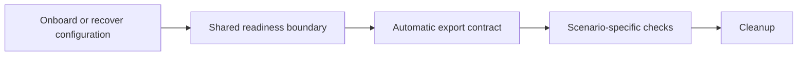

# Recover the symbolic verification state this change produces

A regression report was filed against `NVIDIA/NemoClaw`.  The report is quoted verbatim below.

## Report

```
Investigate automatic config export checks across E2E configurations

## Requested outcome, confirmed scope, and current owner

E2E tests already create many supported configurations, but only selected scenarios explicitly exercise `config export`. Investigate how shared fixtures can check export automatically, so new configurations inherit coverage without each test author remembering to add it.

- Parent: #10904. Its [accepted decision](https://github.com/NVIDIA/NemoClaw/issues/10904#issuecomment-5529712248) establishes read-only export and representative runtime validation.
- Scope: investigate E2E architecture and propose a bounded implementation. This issue does not record acceptance of a particular mechanism or expand supported configurations.
- Current behavior owners: E2E fixtures, typed scenario metadata, the workflow planner, and the existing export checks.
- Assigned implementation owner: none.

## Related work and delivery constraints

Existing export work includes #10938, #11286, #11433, #11434, and #11435. The installed-CLI failure reported in #11421 illustrates why live command coverage matters.

Reuse configurations that existing GitHub E2E jobs already provision. Preserve targeted negative tests and their ownership. Account for direct and transitive assertions; moving checks into a helper must not conceal budget growth.

## Current state and decisions

Preliminary source inspection at `209a02cab4f0223be867619f6fafa58adb722012` found:

- The [host client](https://github.com/NVIDIA/NemoClaw/blob/209a02cab4f0223be867619f6fafa58adb722012/test/e2e/fixtures/clients/host.ts) already performs an automatic managed-image receipt check after eligible successful onboarding commands.
- [Onboarding](https://github.com/NVIDIA/NemoClaw/blob/209a02cab4f0223be867619f6fafa58adb722012/test/e2e/fixtures/phases/onboarding.ts), [state validation](https://github.com/NVIDIA/NemoClaw/blob/209a02cab4f0223be867619f6fafa58adb722012/test/e2e/fixtures/phases/state-validation.ts), and lifecycle fixtures offer semantic boundaries for checking a usable configuration.
- [Registry targets](https://github.com/NVIDIA/NemoClaw/blob/209a02cab4f0223be867619f6fafa58adb722012/test/e2e/live/registry-targets.test.ts) pass through these fixtures. Other live tests use custom onboarding helpers or shell commands, so a single existing hook does not cover every setup path.
- Export checks currently live in the network-policy and Brave scenarios and the [Hermes export helper](https://github.com/NVIDIA/NemoClaw/blob/209a02cab4f0223be867619f6fafa58adb722012/test/e2e/fixtures/hermes-config-export-live.ts). They combine reusable success checks with scenario-specific negative coverage.

Proposed direction:



Investigate the following decisions:

1. Identify setup and recovery owners that can invoke one fixture-owned export contract automatically. Inventory paths that bypass them, including custom launchers, remote execution, historical fixtures, and multiple sandboxes.
2. Derive export expectations from existing scenario intent and independent observations. Do not ask the exporter itself whether a configuration should be supported.
3. Distinguish required successful export, a known expected refusal, and a scenario without a usable sandbox. Unknown coverage must be visible rather than silently skipped.
4. Compare exported semantics with independently expected agent, image, inference, policy, and configured features. Schema validity alone cannot detect silently omitted settings.
5. Decide where repeated export proves stability, which differences require normalization, and when recovery deserves another check. Measure added time and avoid duplicate checks for unchanged state.
6. Reuse existing scenario metadata and workflow selection. Determine how export-source changes select representative configurations without creating another configuration matrix or forcing unrelated jobs.

The failure class is missing configuration coverage at a shared lifecycle boundary. A blanket teardown check is unsuitable: scenarios may intentionally corrupt credentials, stop services, or destroy the sandbox before returning.

Security and failure handling must preserve the existing boundaries. Use the candidate CLI and its intended host or remote context. Keep exports in private temporary files, check known fixture secrets before retaining artifacts, and register cleanup before execution. Preserve existing credential custody and lifetime. Export must not repair the runtime. Command failures, transport ambiguity, verification failures, and cleanup failures must remain distinguishable and must not become successful coverage.

## Observable acceptance examples

| State | Expected result | Shortest evidence |
| --- | --- | --- |
| Supported configuration reaches readiness | Export runs without a call in the test body; document matches independent expectations | Fixture/support tests plus an existing live scenario |
| Export omits an enabled feature, emits invalid configuration, or exposes a fixture secret | Shared contract fails with redacted evidence | Focused support tests |
| Known unsupported configuration | Expected refusal and no published document | Support test plus the existing live owner when needed |
| New configuration lacks an export expectation | Coverage gap is reported explicitly | Metadata/support test |
| Onboarding fails before a usable sandbox exists | Preserve the original failure; no successful-export claim | Support test |
| Scenario later damages or destroys the sandbox | Initial ready-state check already ran; retain targeted negative checks | Existing lifecycle or negative scenario |
| Export command, observation, or cleanup fails | Classify failure, retain safe diagnostics, and attempt owned cleanup | Support tests; live evidence only for the real boundary |

## Capability slices

### Slice 1: Complete the investigation and select the shared boundary

- Outcome: a source-backed map of configuration setup paths, current export coverage, and gaps; one recommended owner and migration plan.
- Acceptance evidence: an architecture diagram, independent expectation design, failure/cleanup rules, workflow-selection impact, and measured or explicitly unmeasured runtime/assertion costs.
- Dependencies and decisions: qualify only accepted export capabilities; identify any additional decision needed before implementation.
- Test plan: identify the smallest support tests and existing GitHub live jobs needed to prove automatic invocation and detect omitted settings.
- Deferred scope: source implementation, new export capabilities, new provisioning matrices, and apply/export round trips.

## Delivery order

Finish the boundary and coverage inventory first. Then propose a small implementation that extracts common success checks and adopts them in existing setup owners. Keep identity-drift and other targeted negative tests with their scenario owners. Extend to further lifecycle boundaries only where they add distinct coverage.

Close this investigation when the recommendation, first implementation slice, dependencies, and remaining gaps are recorded. Do not claim universal E2E coverage while bypass paths remain.

## GitHub writes

Create this investigation issue and attach it as a sub-issue of #10904. No source changes, assignments, or labels are included.
```

## What you have

- `/testbed/repo` is the repository checked out at the **pre-change** commit `ee148f81cc68b759267a22252b28a13eecece741`.  There
  is no git history: read the files directly.
- The pull request that actually fixed this issue is **not** in the container and cannot be fetched.

## Evaluation context

Assume the prospective fix has just **updated an existing non-draft pull request**.

- PR lifecycle action: `synchronize`
- target branch: `main`
- consider both `pull_request` and `pull_request_target` trigger families
- apply the repository's native `types`, `branches`, `branches-ignore`, `paths`, `paths-ignore`
- direct workflow activation only; no push/workflow_dispatch/schedule/workflow_run

## What to produce

Write JSON to `/testbed/answer.json`:

```json
{"case_id": "NVIDIA_NemoClaw__11485__ee148f8",
  "activated_workflows": [".github/workflows/test.yml"]}
```

- list every workflow under `repo/.github/workflows/` that this change would activate
- workflow paths exactly as under `repo/.github/workflows/`; a path that does not exist scores 0

## Rules

- Do **not** use the network. Fetching the upstream fix is cheating and is detected.
- Solve it from the repository.
