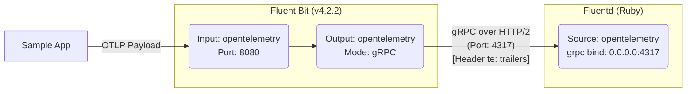

# Recover the symbolic verification state this change produces

A regression report was filed against `fluent/fluent-bit`.  The report is quoted verbatim below.

## Report

```
[out_opentelemetry] Missing mandatory 'te: trailers' header causes gRPC requests to be rejected by strict servers

## Bug Report

**Describe the bug**
The `out_opentelemetry` plugin, when running in gRPC mode,
it does not send the `te: trailers` HTTP/2 header.

While some gRPC implementations might be lenient, 
strict implementations (such as the Ruby grpc gem used by Fluentd) reject requests missing this header,
treating them as a protocol violation.

This results in a situation where the HTTP/2 connection appears successful (HTTP 200 OK), 
but the gRPC call fails internally.


**To Reproduce**
1. Configure Fluentd with fluent-plugin-opentelemetry (which uses the Ruby grpc server).
2. Configure Fluent Bit to send logs/metrics to Fluentd using `out_opentelemetry` with Grpc On.
3. Send OTLP data from sample app.



### sample app
```ruby
require 'bundler/inline'
gemfile do
  source 'https://rubygems.org'
  gem 'opentelemetry-sdk'
  gem 'opentelemetry-metrics-sdk'
  gem 'opentelemetry-exporter-otlp'
  gem 'opentelemetry-exporter-otlp-metrics'
  gem 'opentelemetry-exporter-otlp-logs'
  gem 'opentelemetry-logs-api'
  gem 'opentelemetry-logs-sdk'

  gem 'logger'
end

require 'opentelemetry-sdk'
require 'opentelemetry-logs-sdk'

ENV['OTEL_EXPORTER_OTLP_LOGS_ENDPOINT'] = 'http://localhost:8080/v1/logs'


# Create a LoggerProvider
logger_provider = OpenTelemetry::SDK::Logs::LoggerProvider.new
# Create a batching processor configured to export to the OTLP exporter
processor = OpenTelemetry::SDK::Logs::Export::BatchLogRecordProcessor.new(OpenTelemetry::Exporter::OTLP::Logs::LogsExporter.new)
# Add the processor to the LoggerProvider
logger_provider.add_log_record_processor(processor)
# Access a Logger for your library from your LoggerProvider
logger = logger_provider.logger(name: 'my_app_or_gem', version: '0.1.0')

# Use your Logger to  emit a log record
logger.on_emit(
  timestamp: Time.now,
  severity_text: 'INFO',
  body: 'Thuja plicata',
  attributes: { 'cedar' => true },
)

logger_provider.shutdown
```

### Configuration for Fluentd
```
<source>
  @type opentelemetry
  tag opentelemetry

  <grpc>
    bind 0.0.0.0
    port 4317
  </grpc>

  <http>
    bind 0.0.0.0
    port 4318
  </http>
</source>

<match **>
  @type stdout
</match>
```

### Configuration for Fluent bit
```
[SERVICE]
    Log_Level debug

[INPUT]
    Name opentelemetry
    Host 0.0.0.0
    Port 8080

[OUTPUT]
    Name opentelemetry
    Match *
    Host 0.0.0.0
    Port 4317
    Grpc On
```

**Expected behavior**
According to the gRPC over HTTP/2 specification, the te header with value trailers is mandatory for requests.

> **Call-Definition** → Method Scheme Path [Authority] TE [Timeout] Content-Type [Message-Type] [Message-Encoding] [Message-Accept-Encoding] [User-Agent]

Ref. https://github.com/grpc/grpc/blob/master/doc/PROTOCOL-HTTP2.md

**Screenshots**


**Your Environment**
<!--- Include as many relevant details about the environment you experienced the bug in -->
* Version used: 4.2.2
* Configuration:
* Environment name and version (e.g. Kubernetes? What version?):
* Server type and version:
* Operating System and version:
* Filters and plugins:

**Additional context**
```

## What you have

- `/testbed/repo` is the repository checked out at the **pre-change** commit `9c4137453d364a99d9e434029e50ff2ab7f6b955`.  There
  is no git history: read the files directly.
- The pull request that actually fixed this issue is **not** in the container and cannot be fetched.

## Evaluation context

Assume the prospective fix has just **updated an existing non-draft pull request**.

- PR lifecycle action: `synchronize`
- target branch: `master`
- consider both `pull_request` and `pull_request_target` trigger families
- apply the repository's native `types`, `branches`, `branches-ignore`, `paths`, `paths-ignore`
- direct workflow activation only; no push/workflow_dispatch/schedule/workflow_run

## What to produce

Write JSON to `/testbed/answer.json`:

```json
{"case_id": "fluent_fluent_bit__11332__9c41374",
  "activated_workflows": [".github/workflows/test.yml"]}
```

- list every workflow under `repo/.github/workflows/` that this change would activate
- workflow paths exactly as under `repo/.github/workflows/`; a path that does not exist scores 0

## Rules

- Do **not** use the network. Fetching the upstream fix is cheating and is detected.
- Solve it from the repository.
