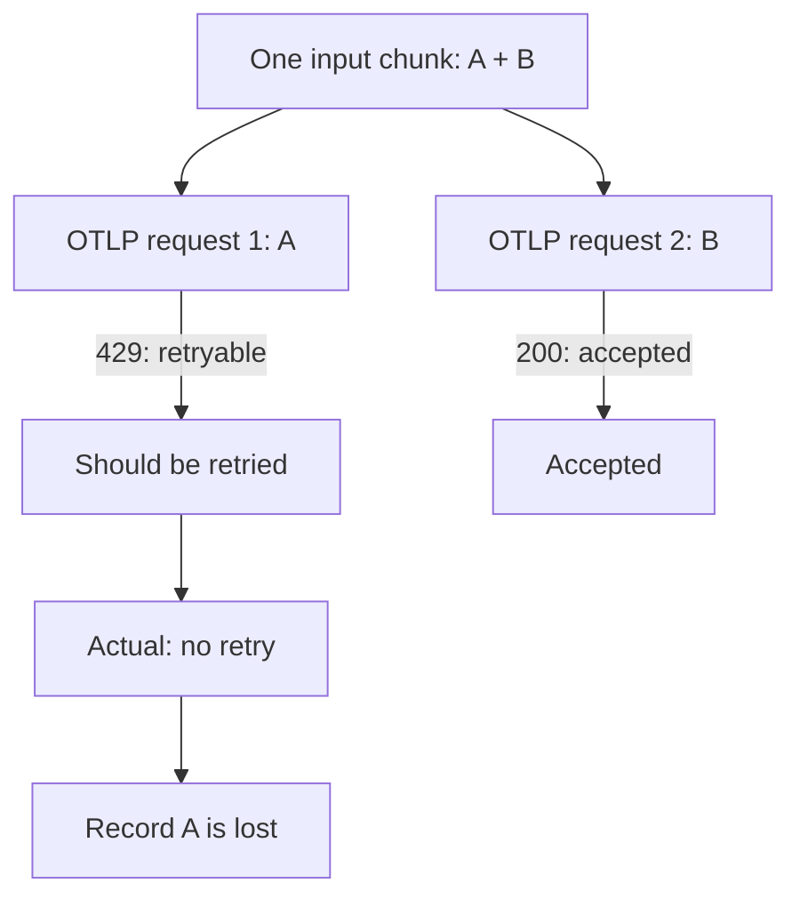

# Recover the symbolic verification state this change produces

A regression report was filed against `fluent/fluent-bit`.  The report is quoted verbatim below.

## Report

```
[BUG] Fluent Bit 5.1.1 loses records after an earlier OTLP/HTTP 429

## Short version

Fluent Bit receives two records, sends them as two HTTP requests, and gets:

```text
record A → HTTP 429 (not accepted; retry later)
record B → HTTP 200 (accepted)
```

Fluent Bit then marks the whole input as successful and does not retry record
A. The destination accepted one record; Fluent Bit reports two. This is data
loss.



HTTP 429 means “the request was not accepted; try again”. Retrying the whole
chunk would be acceptable, even if record B were duplicated.

## Reproduce locally

The appendix contains the exact three tested files. They use only
`fluent/fluent-bit:5.1.1` and `python:3.12.13-slim`: no build, pip, cluster,
external backend or published ports.

Save the three files into one directory and run:

```bash
export DOCKER_API_VERSION=1.44  # only for docker-compose 2.17.x
docker-compose -p fb429-minimal up --abort-on-container-exit --exit-code-from test
docker-compose -p fb429-minimal down -v
```

Default: `BATCH_SIZE=1 FAIL_REQUEST=1`. The test sends two records in one
input array. `BATCH_SIZE` controls records per OTLP request; `FAIL_REQUEST`
selects the request that receives HTTP 429:

```bash
# Main case: the first record is lost.
BATCH_SIZE=1 FAIL_REQUEST=1 docker-compose -p fb429-minimal up --abort-on-container-exit --exit-code-from test

# Reverse order: the chunk is retried; one duplicate is expected.
BATCH_SIZE=1 FAIL_REQUEST=2 docker-compose -p fb429-minimal up --abort-on-container-exit --exit-code-from test

# Control: no failure.
BATCH_SIZE=1 FAIL_REQUEST=0 docker-compose -p fb429-minimal up --abort-on-container-exit --exit-code-from test

# Same bug at scale: 2000 records, two requests.
BATCH_SIZE=1000 FAIL_REQUEST=1 docker-compose -p fb429-minimal up --abort-on-container-exit --exit-code-from test
BATCH_SIZE=1000 FAIL_REQUEST=2 docker-compose -p fb429-minimal up --abort-on-container-exit --exit-code-from test
```

## Expected vs actual

For `429 → 200`, both unique IDs must eventually arrive. Retrying the whole
chunk, with a duplicate of an already accepted record, is acceptable.

Verified locally on 2026-09-07:

| Input / batch | Responses | Accepted | Missing | Duplicates | Retries |
|---|---|---:|---:|---:|---:|
| 2 / 1 | `429, 200` | 1 | 1 | 0 | 0 |
| 2 / 1 | `200, 429` | 2 | 0 | 1 | 1 |
| 2000 / 1000 | `429, 200` | 1000 | 1000 | 0 | 0 |
| 2000 / 1000 | `200, 429` | 2000 | 0 | 1000 | 1 |

Main two-record output:

```text
Request 1: HTTP 429, 1 records, event-000000..event-000000
Request 2: HTTP 200, 1 records, event-000001..event-000001
Engine successfully processed: 2
Receiver accepted: 1; missing: 1; duplicates: 0
Responses: [429, 200]
BUG REPRODUCED: rejected records were lost
```

The log contains exactly one task creation and destruction, so both records
were handled as one internal unit and that unit was finished without retry:

```text
[task] created task=... id=0 OK
[task] destroy task=... (task_id=0)
```

Fluent Bit also reports two processed records while the receiver accepted one:

```text
fluentbit_input_records_total{name="http.0"} 2
fluentbit_output_proc_records_total{name="opentelemetry.0"} 2
fluentbit_output_retried_records_total{name="opentelemetry.0"} 0
fluentbit_output_retries_total{name="opentelemetry.0"} 0
fluentbit_output_errors_total{name="opentelemetry.0"} 0
fluentbit_output_dropped_records_total{name="opentelemetry.0"} 0
```

At scale, the first 1000 of 2000 records are missing in the same `429 → 200`
scenario. Both scales produce one task.

## Suspected cause

In [`otel_process_logs` in v5.1.1](https://github.com/fluent/fluent-bit/blob/v5.1.1/plugins/out_opentelemetry/opentelemetry_logs.c), a later successful batch can overwrite an earlier `FLB_RETRY` result with `FLB_OK`. The whole input unit is then reported as successful. HTTP 429 is classified in [`opentelemetry.c`](https://github.com/fluent/fluent-bit/blob/v5.1.1/plugins/out_opentelemetry/opentelemetry.c); the suspected bug is losing the earlier retry result, not recognizing 429.

## Environment and limitations

- Fluent Bit `5.1.1`, commit `6315162a8d`; `opentelemetry` over OTLP/HTTP.
- Built-in HTTP input, one input array, no filters, one output worker.
- `Retry_Limit no_limits`; local Docker/Colima only.
- The receiver finds event IDs by searching known ASCII markers in the
  uncompressed Protobuf body; it is not a full Protobuf decoder.

Related: [#10821](https://github.com/fluent/fluent-bit/issues/10821) (gRPC
loss under load, cause unknown), [#10481](https://github.com/fluent/fluent-bit/issues/10481)
(HTTP retry classification), [PR #10497](https://github.com/fluent/fluent-bit/pull/10497)
(status classification, not batching).

## Appendix: exact tested files

### `compose.yaml`

```yaml
services:
  test:
    image: python:3.12.13-slim
    command: ["python", "-u", "/test.py"]
    environment:
      FAIL_REQUEST: ${FAIL_REQUEST:-1}
      BATCH_SIZE: ${BATCH_SIZE:-1}
    volumes:
      - ./test.py:/test.py:ro
    networks: [repro]
  fluent-bit:
    image: fluent/fluent-bit:5.1.1
    command: ["-c", "/fluent-bit/etc/repro.conf"]
    environment:
      BATCH_SIZE: ${BATCH_SIZE:-1}
    volumes:
      - ./fluent-bit.conf:/fluent-bit/etc/repro.conf:ro
    networks: [repro]
networks:
  repro:
    internal: true
```

### `fluent-bit.conf`

```ini
[SERVICE]
    Flush             2
    Grace             2
    Log_Level         debug
    HTTP_Server       On
    HTTP_Listen       0.0.0.0
    HTTP_Port         2020
    scheduler.base    1
    scheduler.cap     2

[INPUT]
    Name              http
    Listen            0.0.0.0
    Port              9880

[OUTPUT]
    Name              opentelemetry
    Match             repro
    Host              test
    Port              8080
    grpc              Off
    http2             Off
    tls               Off
    logs_uri          /v1/logs
    logs_body_key     $message
    batch_size        ${BATCH_SIZE}
    Retry_Limit       no_limits
    Workers           1
```

### `test.py`

```python
import json
import os
import re
import threading
import time
import urllib.request
from http.server import BaseHTTPRequestHandler, HTTPServer

batch_size = int(os.environ.get("BATCH_SIZE", "1"))
fail_request = int(os.environ.get("FAIL_REQUEST", "1"))
expected = {f"event-{i:06d}" for i in range(2 * batch_size)}
accepted = []
statuses = []
metrics_url = "http://fluent-bit:2020/api/v1/metrics/prometheus"


class Receiver(BaseHTTPRequestHandler):
    protocol_version = "HTTP/1.1"

    def do_POST(self):
        body = self.rfile.read(int(self.headers["Content-Length"]))
        ids = [s.decode() for s in re.findall(rb"event-\d{6}", body)]
        assert self.path == "/v1/logs"
        assert len(ids) == batch_size and set(ids) <= expected
        status = 429 if len(statuses) + 1 == fail_request else 200
        statuses.append(status)
        if status == 200:
            accepted.extend(ids)
        print(f"Request {len(statuses)}: HTTP {status}, {len(ids)} records, {ids[0]}..{ids[-1]}")
        self.send_response(status)
        self.send_header("Content-Type", "application/x-protobuf")
        self.send_header("Content-Length", "0")
        self.end_headers()

    def log_message(self, *args):
        pass


server = HTTPServer(("0.0.0.0", 8080), Receiver)
threading.Thread(target=server.serve_forever, daemon=True).start()


def metrics():
    with urllib.request.urlopen(metrics_url, timeout=2) as response:
        return response.read().decode()


def counter(snapshot, name):
    match = re.search(rf"^{name}\{{[^\n]*\}} (\d+)", snapshot, re.MULTILINE)
    return int(match[1]) if match else -1


deadline = time.monotonic() + 30
while True:
    try:
        metrics()
        break
    except (OSError, TimeoutError):
        if time.monotonic() >= deadline:
            raise RuntimeError("Fluent Bit did not become ready")
        time.sleep(0.2)

records = [{"message": event_id} for event_id in sorted(expected)]
request = urllib.request.Request(
    "http://fluent-bit:9880/repro",
    data=json.dumps(records).encode(),
    headers={"Content-Type": "application/json"},
)
with urllib.request.urlopen(request, timeout=5) as response:
    assert response.status == 201

deadline = time.monotonic() + 30
while True:
    snapshot = metrics()
    if counter(snapshot, "fluentbit_output_proc_records_total") == len(expected):
        break
    if time.monotonic() >= deadline:
        raise RuntimeError("Inconclusive: engine did not successfully finish all records")
    time.sleep(0.2)

assert counter(snapshot, "fluentbit_input_records_total") == len(expected)
missing = expected - set(accepted)
print(f"Engine successfully processed: {len(expected)}")
print(f"Receiver accepted: {len(set(accepted))}; missing: {len(missing)}; duplicates: {len(accepted) - len(set(accepted))}")
print(f"Responses: {statuses}")
print("BUG REPRODUCED: rejected records were lost" if missing else "All records delivered")
print(snapshot)
```
```

## What you have

- `/testbed/repo` is the repository checked out at the **pre-change** commit `f78472443d32691c319c424c75d9ea2343dbc8f7`.  There
  is no git history: read the files directly.
- The pull request that actually fixed this issue is **not** in the container and cannot be fetched.

## Evaluation context

Assume the prospective fix has just **updated an existing non-draft pull request**.

- PR lifecycle action: `synchronize`
- target branch: `master`
- consider both `pull_request` and `pull_request_target` trigger families
- apply the repository's native `types`, `branches`, `branches-ignore`, `paths`, `paths-ignore`
- direct workflow activation only; no push/workflow_dispatch/schedule/workflow_run

## What to produce

Write JSON to `/testbed/answer.json`:

```json
{"case_id": "fluent_fluent_bit__12384__f784724",
  "activated_workflows": [".github/workflows/test.yml"]}
```

- list every workflow under `repo/.github/workflows/` that this change would activate
- workflow paths exactly as under `repo/.github/workflows/`; a path that does not exist scores 0

## Rules

- Do **not** use the network. Fetching the upstream fix is cheating and is detected.
- Solve it from the repository.
